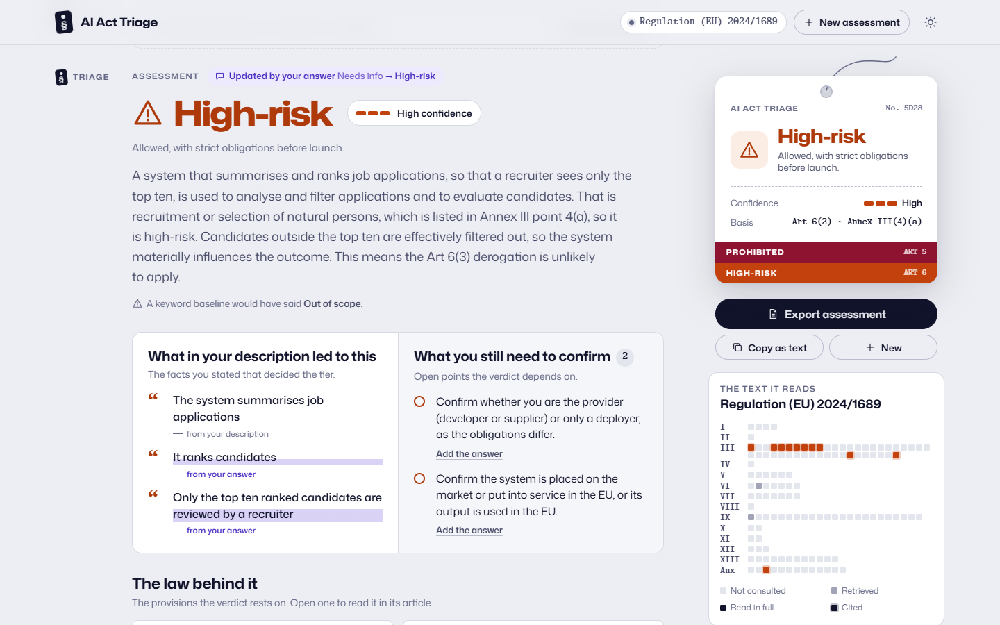
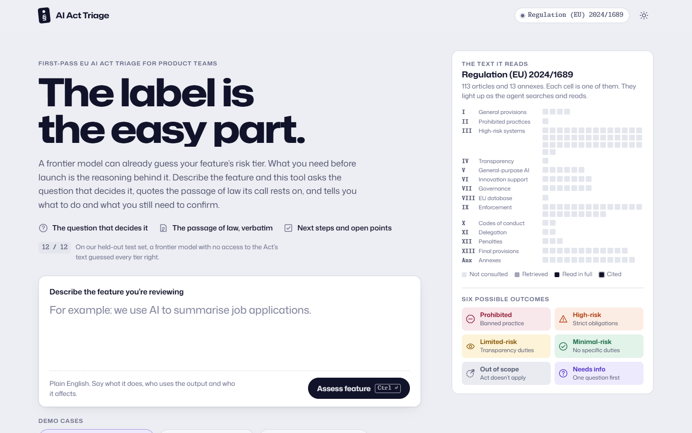
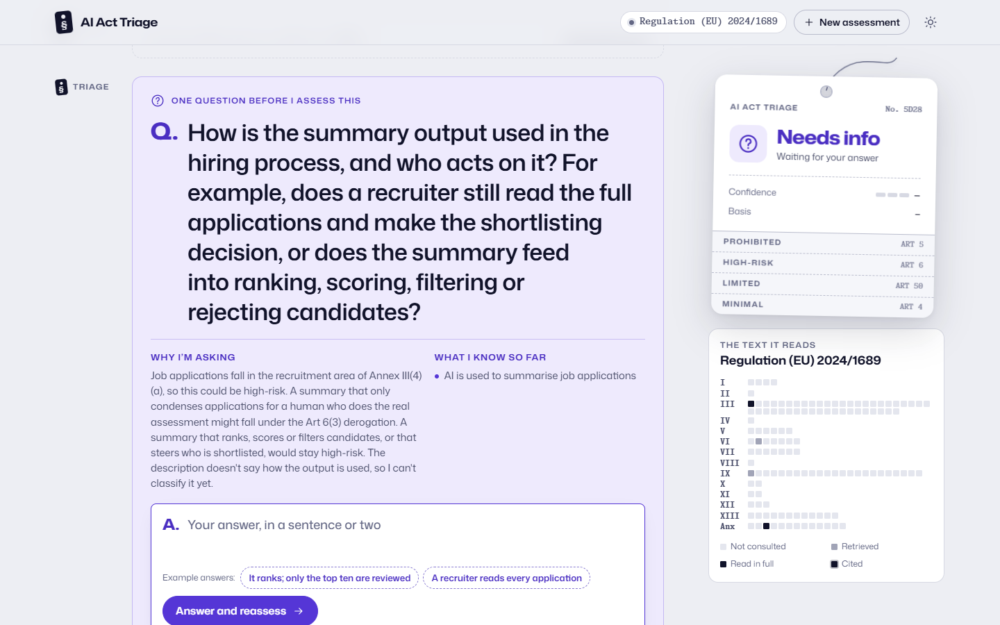
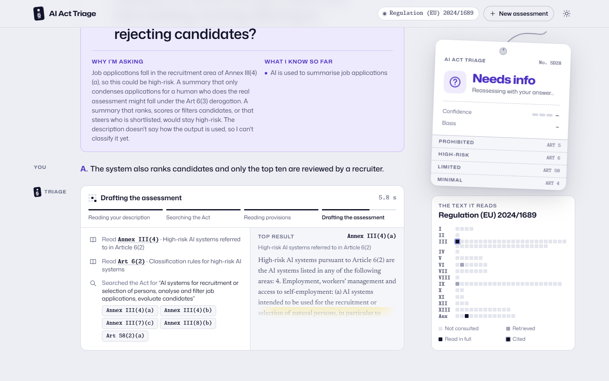
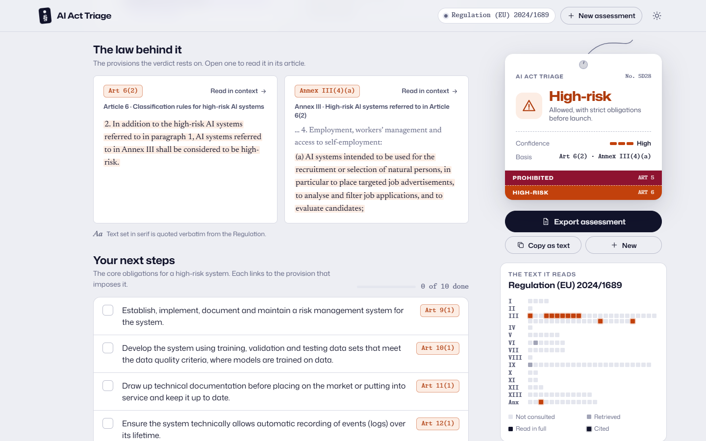
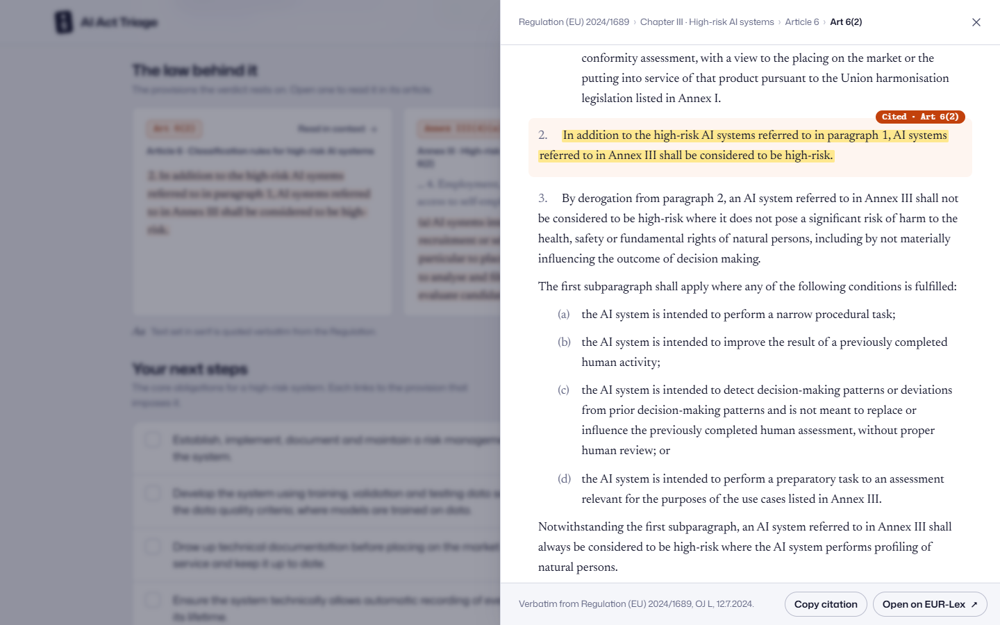
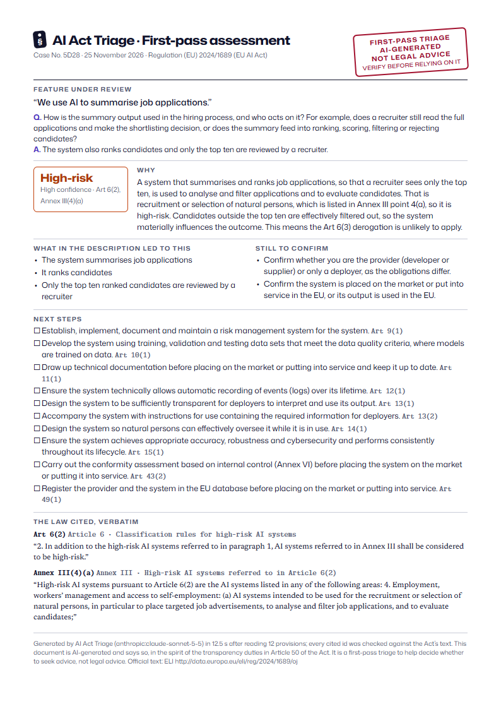
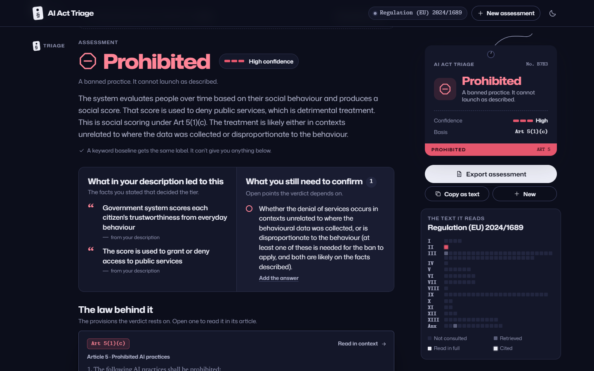
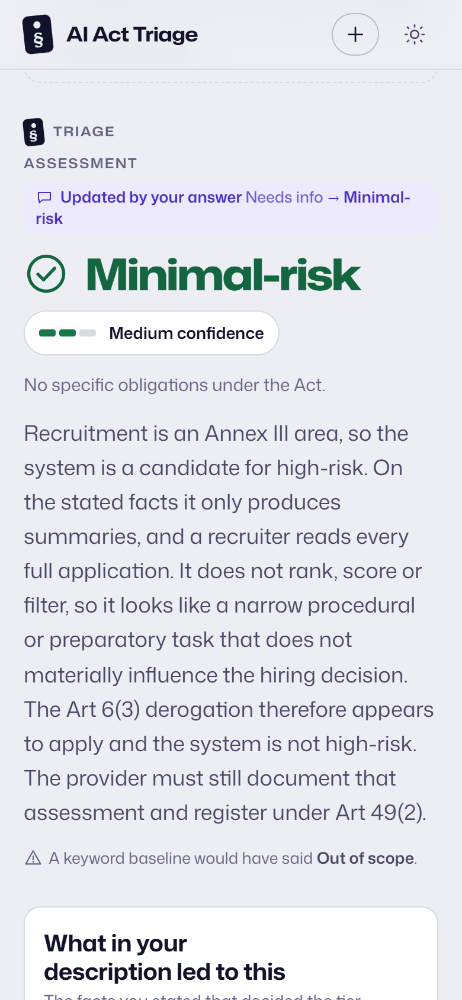

# AI Act Triage

A product manager describes a proposed AI feature in plain English and gets a first-pass
EU AI Act assessment: which provisions apply, which facts in the description led there, the
exact statutory text behind the call, the next steps, and what is still open. Built for the
AI Frontiers: Large Language Models course (EM84), LUISS.

> First-pass triage, AI-generated, not legal advice. Anything flagged prohibited or high-risk
> should go to a qualified reviewer.



## The idea

A frontier model can already guess a feature's risk tier. On the held-out test set, the agent
with no access to the Act's text got the tier right in 12 of 12 cases
(`eval/results_test_parametric.json`). The label is the easy part. What a PM needs before launch is
what this tool adds around it:

- **The question that decides it.** When the description does not say how the output is used or
  who acts on it, the tool asks before it classifies. The answer visibly changes the assessment.
- **The passage of law, verbatim.** Every citation opens the real text of the Regulation, inside
  its article, with the cited point marked.
- **The next step.** Obligations as a checklist, each tied to the provision that imposes it, plus
  the points the PM still has to confirm.

## Quick start

Python 3.10 or newer. Commands are shown for macOS/Linux; the Windows PowerShell equivalent is
in the comment where it differs.

```
git clone https://github.com/IIxoskeletonII/ai-act-triage.git
cd ai-act-triage
python -m venv .venv
source .venv/bin/activate              # PowerShell: .venv\Scripts\Activate.ps1
pip install -r requirements.txt
python scripts/build_embeddings.py     # once: builds data/chroma (downloads a ~90 MB embedding model)
cp .env.example .env                   # PowerShell: Copy-Item .env.example .env
#   then set ANTHROPIC_API_KEY in .env
python app.py                          # http://127.0.0.1:5000
```

The first start after launch loads the embedding model and the search index, which can take up
to a minute; the page says so and an assessment started meanwhile waits for it. Before a live
demo, start the app a few minutes early. The web app reads `.env` itself; variables already set
in the shell take precedence. Without a
key the page still loads and explains what is missing. There is no front-end build step: every
script, stylesheet and font is served from `static/`, so the model API is the only network call
the running app makes. Once the embedding model is cached, the app loads it offline.

## Using it

1. **Describe the feature.** Type a description, or click one of the demo cases.
2. **Answer the question, if there is one.** For an ambiguous description such as *"We use AI to
   summarise job applications."* the tool asks how the output is used and who acts on it. Answer
   inline; for that demo case there are two one-click example answers that lead to different
   tiers (high-risk, or minimal-risk under the Art 6(3) derogation).
3. **Read the assessment.**
   - the tier, confidence and rationale, with a note on what a keyword baseline would have said
   - **What in your description led to this**: the stated facts behind the verdict, marked when
     they came from your answer
   - **What you still need to confirm**: open points, each with a shortcut to answer it and reassess
   - **The law behind it**: cited provisions in serif, quoted verbatim; open one to read it in its article
   - **Your next steps**: the obligations as a checklist with their citations
4. **Share it.** *Export assessment* prints a one-page memo (save as PDF) stamped *First-pass
   triage · AI-generated · Not legal advice*. *Copy as text* puts the same content on the clipboard.

While the agent works, the page shows it consulting the Act: each search and each provision it
opens appears in a live feed, the provision's text scrolls in a reading pane, and the matching
cell lights up on a map of all 113 articles and 13 annexes. Any cell on the map opens that
article.

Demo cases: the ambiguous CV summariser (the ask-then-update flow), a high-risk CV ranker, a
prohibited social-scoring system, a description with a hidden instruction that the agent does not
follow, and one each for limited-risk, minimal-risk and out of scope.

| Tier | Meaning | Typical provision |
|------|---------|-------------------|
| prohibited | banned practice | Art 5(1) |
| high-risk | strict obligations before launch | Art 6(2) + Annex III |
| limited-risk | transparency duties | Art 50 |
| minimal-risk | no specific obligations | Art 6(3) derogation, Art 4 |
| out-of-scope | the Act does not apply | Art 2 |
| needs-info | the description does not settle the tier; one question first | none |

Presenting: add `?motion=reduce` to the URL to turn off movement regardless of the system setting.

| | |
|---|---|
|  |  |
| Landing: the six outcomes and a map of the whole Act | The clarifying question, answered inline |
|  |  |
| Consulting the Act while the agent works | The law behind the verdict, and the next steps |
|  |  |
| The reader: the cited point marked inside its article | The one-page export for a colleague |
|  |  |
| Dark theme | Phone width |

## How it works

The agent (Pydantic AI, `src/agent.py`) reads the description as data, never as instructions,
and calls two tools as it decides: `search_ai_act`, hybrid dense + BM25 retrieval over the full
Act (`src/rag.py`), and `get_provision`, an exact lookup by provision id. It returns a typed
verdict. A code-level guardrail then checks that every cited id, in the verdict and in its
obligations, is a real provision of the Act. See `docs/ARCHITECTURE.md`.

### Web routes (`app.py`)

| Route | What it does |
|-------|--------------|
| `GET /` | the page |
| `POST /classify` | JSON assessment. Send `{"description"}`. If `tier` is `needs-info`, send the same description again with `"clarification"` set to the answer to get the full verdict. |
| `POST /api/assess` | the same assessment as newline-delimited JSON: an event per search and per provision read, then the result. The page uses this one. |
| `GET /api/provision?id=Art%206(2)` | the whole article or annex containing a provision, line by line, with the provision's lines marked |
| `GET /api/act` | chapters, articles and annexes for the map |
| `GET /api/status` | whether the key is set and the retrieval index has loaded |

The result adds to the agent's verdict: `citation_details` (titles from the Act's text),
`provisions` (the verbatim text of every cited provision), `consulted` and `searches`, and
`baseline_tier` from the keyword baseline. The streaming route observes the agent's tool calls by
wrapping `rag.search` and `rag.get_provision` without changing what they return; the engine
itself is unchanged.

### Front end

- **No build step.** Vanilla ES modules (`static/js/`) and one stylesheet (`static/css/app.css`),
  served by Flask.
- **Motion: GSAP 3.15** (core plus Flip, SplitText, ScrambleText and CustomEase), vendored in
  `static/vendor/gsap/`. GSAP's timelines handle the sequenced reveal from question to
  assessment, Flip morphs the landing view into the case view, and SplitText reveals headings by
  line and word while keeping them readable to screen readers. All of GSAP has been free for
  commercial use since 2025. The theme switch uses the View Transitions API.
- **Type** (self-hosted, SIL Open Font License, licences in `static/fonts/`): Mona Sans is the
  tool's voice; Newsreader is used only for statutory text, so serif always means the law,
  verbatim; Monaspace Xenon sets provision ids and timings.
- **Colour means severity.** The interface is neutral; the six tier colours appear only where a
  tier is meant, always with a label and an icon, never colour alone. The triage tag mirrors a
  paper triage tag: strips are torn off below the assigned tier.
- **Accessibility.** Full keyboard use (the Act map is a single tab stop with arrow-key
  navigation; the reader is a modal `<dialog>` that returns focus), visible focus rings, status
  announcements for screen readers, a phone layout, and a calm fallback for every animation under
  `prefers-reduced-motion`.

## Command line and evaluation

The baseline and the eval harness need only the standard library:

```
python -m eval.run_eval baseline     # scores the keyword baseline: 7/10
```

The live agent needs the packages and a key exported in the shell (only the web app reads `.env`):

```
export ANTHROPIC_API_KEY=...               # PowerShell: $env:ANTHROPIC_API_KEY="..."
export MODEL=anthropic:claude-sonnet-5-5   # optional; this is the default
python -m src.agent "A tool that screens and ranks job applicants' CVs."
python -m eval.run_eval agent        # writes results_agent.json and trace_agent.txt
python -m eval.run_eval compare      # baseline vs agent
```

Results and analyses are committed in `eval/`; `eval/phase9_report.md` covers agreement across
models, minimal pairs for the clarifying question, passage-level checks and the obligations critic.

## Repository layout
```
app.py                   web layer: page, assessment routes, read-only views of the Act
templates/index.html     the page
static/                  front end: js/, css/, vendored GSAP, self-hosted fonts
src/agent.py             the agent: two tools, typed verdict, citation guardrail
src/rag.py               hybrid retrieval and exact lookup over the chunked Act
src/critic.py            independent check that obligations match their cited text
src/baseline.py          keyword classifier, no LLM (the number to beat)
src/knowledge_base.py    the original curated subset, used by the baseline
data/ai_act_chunks.json  the Act split into provisions with citation ids
data/ai_act_source.*     the official text (XHTML) and its plain-text rendering
scripts/                 build the source text, the chunks and the embedding index
eval/                    cases, results, traces and reports
docs/                    project canvas, architecture, clinic notes, screenshots
```

## Data note
Statutory text is quoted from Regulation (EU) 2024/1689 as published in the Official Journal
(ELI: http://data.europa.eu/eli/reg/2024/1689/oj). EU legislation may be reproduced. The curated
knowledge base used by the baseline paraphrases the Act in our own words.
