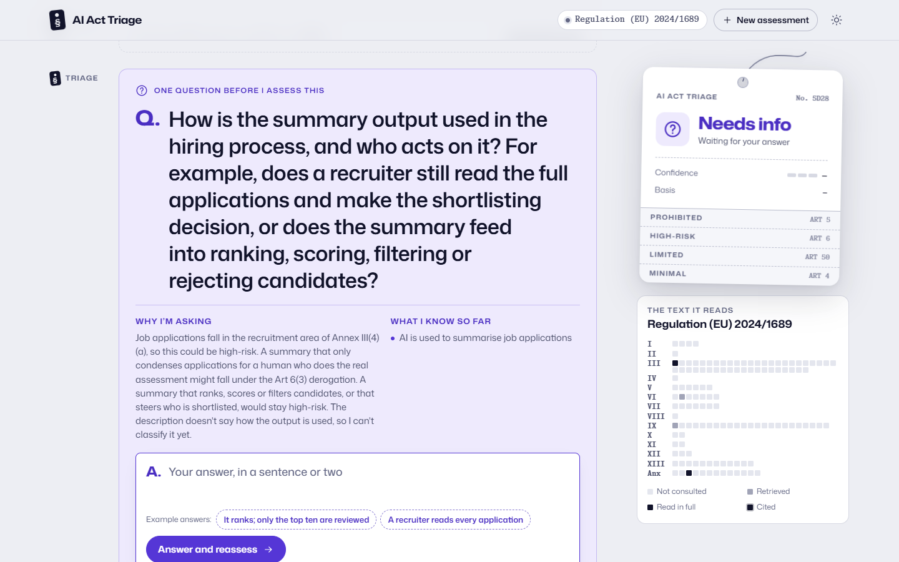

# User guide

AI Act Triage gives a first-pass reading of how the EU AI Act applies to an AI feature. You describe the feature in plain English and the tool tells you which risk tier it probably falls into, which articles of the Act that rests on (quoted from the real text), which facts in your description led there, and what you would need to do next.

It is meant for product managers and other non-lawyers who want a starting point before talking to legal. It is not legal advice, and anything marked prohibited or high-risk should be checked by a qualified reviewer.

## Contents

1. How to use it
2. What each part of the answer means
3. A worked example
4. Limits and when to ask a lawyer
## 1. How to use it

Start the app (see the Quick start in the README) and open http://127.0.0.1:5000.

**Describe the feature.** Write a few sentences about what the AI does, who uses it and what happens with its output. You can also click one of the demo cases to see how the tool behaves on a known example.

**Answer the question, if there is one.** If your description doesn't say enough to decide the tier, the tool asks one clarifying question before it classifies. This usually happens when it's unclear how the output is used or who acts on it. Answer it in the box that appears. For the CV summariser demo there are two example answers you can click, and they lead to different tiers.

**Wait while it reads the Act.** While the agent works, the page shows each search it runs and each article it opens. The matching cell lights up on the map of the Act (113 articles and 13 annexes). This takes a few seconds, and up to a minute on the first run while the search index loads.

**Read the assessment.** Section 2 below explains each part.

**Share it.** "Export assessment" prints a one-page memo you can save as PDF, and "Copy as text" copies the same content to the clipboard. Both are marked as a first-pass, AI-generated triage and not legal advice.

